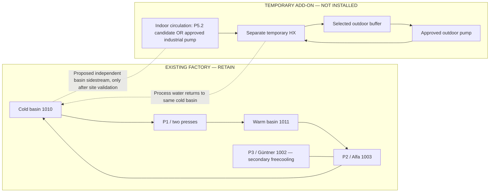

# Cooling concept — current plant versus temporary add-on

**Evidence date: 23 November 2026.** Functional overview, not installation instructions. Physical connections, current valve configuration and measured performance remain unconfirmed.

## Existing functions to preserve

The factory uses a **cold process-water basin (1010)**, two vinyl presses supplied by the existing **P1 press circulation**, and a **warm return basin (1011)**. The existing **P2 / Alfa Laval 1003** path is associated with transfer and heat exchange between hot-return and cold process water. A separate **P3 / Güntner 1002 freecooling path** uses secondary fluid; **P4 / Güntner 1001** belongs to a different condenser/rejection function. The currently useful contribution of any branch must be measured rather than assumed.

These are functional IDs inferred from historical engineering information and photo evidence; their final as-built correspondence needs site confirmation. The existing main cooling machine is not declared operational by this document.

## Proposed temporary module — not installed

**Indoors / process side:** a verified side circulation function from the **same cold basin**, through one side of a suitable separating heat exchanger, and back to that **same basin**. The existing pump labelled **P5.2** is a candidate for this duty only after the responsible installer verifies its identity, functionality, hydraulics and controls.

**Outdoors / buffer side:** fluid from **one selected outdoor IBC** may circulate via a suitable dedicated pump through the other side of the heat exchanger and return to the **same selected IBC**. Other filled containers could be reserves. The two sides exchange heat **without mixing liquids**.

**One selected IBC means one matched withdrawal-and-return pair**; tank changes require an engineered method. A pump circulates fluid, but does not create cooling energy. The outdoor tank gradually rejects heat to colder air and may need time to recharge.

### Simplified illustration (functional only)

The illustration shows *functions*, not piping direction or permissions for the actual installed valves.

## Alternative to investigate before buying

The installer should compare the existing **P2/Alfa/freecooling** performance with P5.2 reuse and a fully independent temporary module. Reconfiguring an occupied heat-exchanger passage might remove useful current freecooling and create fluid/pressure incompatibilities. No photographed exchanger side should be assumed spare.

## Environmental and safety limits

- Outdoor IBCs are vented storage tanks, **not** pressurized industrial process vessels.
- If the outside temperature can freeze the fluid, the installer must define the overnight and power-loss state for hoses, valves, pumps and HX.
- Do not connect an outdoor water buffer directly to an existing glycol or pressurized mould circuit without a fully engineered fluid/pressure separation strategy.
- Do not override the main cooling machine's fault or protection chain. A responsible qualified contractor approves any change and commissioning.
- Heat balance, sustained two-press operation and record quality remain **unverified** until representative testing.
