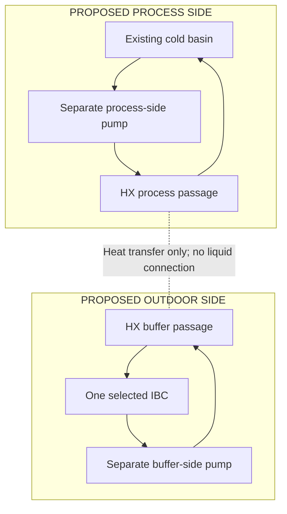

# Cooling concept — current plant versus temporary add-on

**Evidence date: 24 November 2026, early-morning review.** Functional overview, not installation instructions. Physical connections, current valve configuration and measured performance remain unconfirmed.

> Read the [24–27 November brief](CURRENT-TEAM-BRIEF-2026-11-24.md) for updated purchases, delivery and winter hold points. The drawing below is a functional concept, not an approved assembly drawing.

## Existing functions to preserve

The factory uses a **cold process-water basin (1010)**, two vinyl presses supplied by the existing **P1 press circulation**, and a **warm return basin (1011)**. The existing **P2 / Alfa Laval 1003** path is associated with transfer and heat exchange between hot-return and cold process water. A separate **P3 / Güntner 1002 freecooling path** uses secondary fluid; **P4 / Güntner 1001** belongs to a different condenser/rejection function. The currently useful contribution of any branch must be measured rather than assumed.

These are functional IDs inferred from historical engineering information and photo evidence; their final as-built correspondence needs site confirmation. The existing main cooling machine is not declared operational by this document.

## Proposed temporary module — not installed

**Indoors / process side:** a verified side circulation function from the **same cold basin**, through one isolated passage of a suitable separating heat exchanger, and back to that **same basin**. The current concept requires a suitable independently provided pump for this duty. **P5.2 remains installed in its existing circuit and is not assigned to the temporary module.**

**Outdoors / buffer side:** fluid from **one selected outdoor IBC** may circulate via a suitable dedicated pump through the other side of the heat exchanger and return to the **same selected IBC**. Other filled containers could be reserves. The two sides exchange heat **without mixing liquids while the separating plates remain intact**; assess internal-leak consequences.

**One selected IBC means one matched withdrawal-and-return pair**; tank changes require an engineered method. A pump circulates fluid, but does not create cooling energy. The outdoor tank gradually rejects heat to colder air and may need time to recharge.

### Simplified illustration (functional only)

The two HX boxes represent **two isolated liquid passages in one heat exchanger**, not two separate exchangers. The arrows show proposed circulation functions, not the physical port positions or valve arrangement. Both duties require validated equipment and site approval; the illustration does not authorize filling or starting the module. The existing press circulation and cooling functions remain in place and are omitted here for clarity.

## Alternative to investigate before buying

The installer should quantify useful existing **P2/Alfa/freecooling** performance and compare it with a fully independent temporary module or a supplied temporary cooler. **P5.2 stays in place under the current plan.** Reconfiguring an occupied exchanger passage could remove useful existing cooling and create fluid/pressure incompatibilities. No exchanger passage should be assumed spare.

## Environmental and safety limits

- Outdoor IBCs are vented storage tanks, **not** pressurized industrial process vessels.
- **Outdoor filling and operation remain on hold** until the installer has defined and accepted the overnight and power-loss state for tanks, hoses, valves, pumps and HX. Emptying visible hoses alone does not verify complete drainage.
- Do not connect an outdoor water buffer directly to an existing glycol or pressurized mould circuit without a fully engineered fluid/pressure separation strategy.
- Do not override the main cooling machine's fault or protection chain. A responsible qualified contractor approves any change and commissioning.
- Heat balance, sustained two-press operation and record quality remain **unverified** until representative testing.

